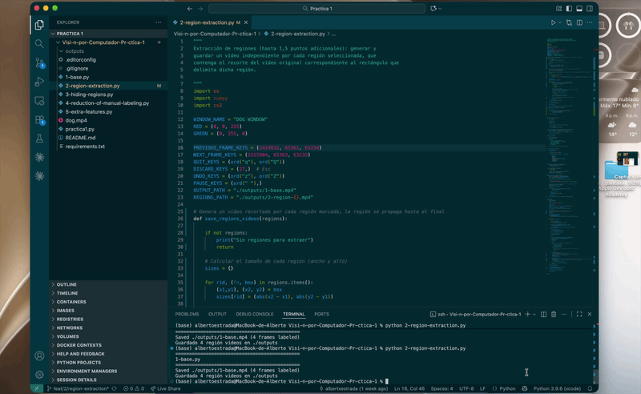
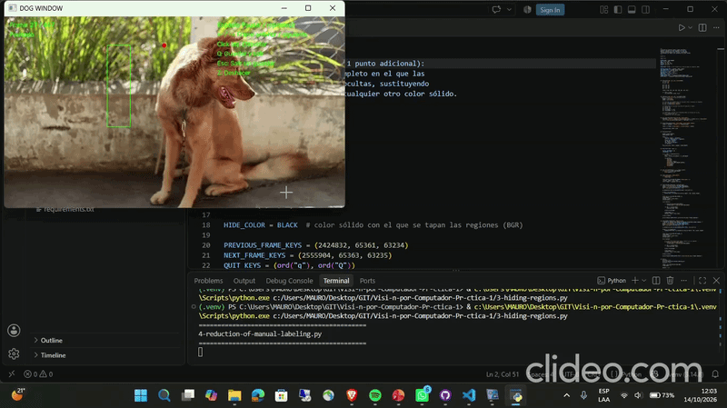
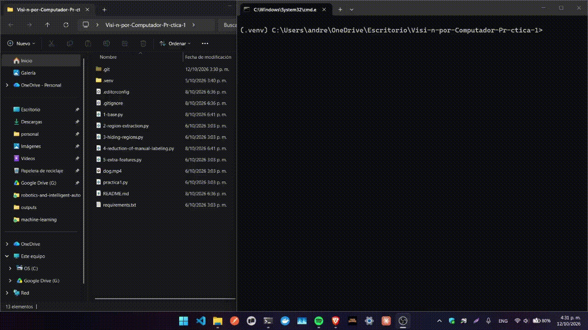

# Visión por Computador — Práctica 1

**Manejo de archivos, cámaras e imágenes · MUCSI · Universidad de Deusto · 2026-27**

Herramienta de etiquetado de vídeo desarrollada con OpenCV. Permite recorrer un vídeo frame a frame, marcar regiones con el ratón y generar nuevos vídeos a partir de esas regiones.

**Autores**

| Nombre | Correo | GitHub | Apartado |
| --- | --- | --- | --- |
| Jorge Vargas | j.vargas@opendeusto.es | [@JorgeAVargasC](https://github.com/JorgeAVargasC) | 4 — Reducción del etiquetado manual |
| Alberto Estrada | alberto.estrada@opendeusto.es | [@albertxestrada](https://github.com/albertxestrada) | 2 — Extracción de regiones |
| Katherine Lorenzo | katherine.lorenzo@opendeusto.es | [@klorenzoe](https://github.com/klorenzoe) | 5 — Funcionalidades extra |
| Mauro Cornejo | maurorodrigo.cornejo@opendeusto.es | [@Maux112](https://github.com/Maux112) | 3 — Ocultación de regiones |

La funcionalidad básica (apartado 1) se desarrolló entre todos los miembros del grupo.

**Docente:** Iker Pastor (iker.pastor@deusto.es)

**Repositorio:** [github.com/albertxestrada/Visi-n-por-Computador-Pr-ctica-1](https://github.com/albertxestrada/Visi-n-por-Computador-Pr-ctica-1)

## Estado de la práctica

| Script | Apartado | Puntos | Responsable |
| --- | --- | --- | --- |
| `1-base.py` | Funcionalidad básica | 5 | Todo el grupo |
| `2-region-extraction.py` | Extracción de regiones | hasta 1,5 | Alberto Estrada |
| `3-hiding-regions.py` | Ocultación de regiones | hasta 1 | Mauro Cornejo |
| `4-reduction-of-manual-labeling.py` | Reducción del etiquetado manual | hasta 1,5 | Jorge Vargas |
| `5-extra-features.py` | Funcionalidades extra | hasta 1 | Katherine Lorenzo |

---

## Instalación

**Requisitos:** Python 3 (probado con Python 3.14) y las dependencias de `requirements.txt` (`numpy`, `opencv-python`).

1. Crear el entorno virtual:

   ```bash
   python -m venv .venv
   ```

2. Activarlo.

   Windows (PowerShell):

   ```powershell
   .venv\Scripts\Activate.ps1
   ```

   Linux / macOS:

   ```bash
   source .venv/bin/activate
   ```

3. Instalar las dependencias:

   ```bash
   pip install -r requirements.txt
   ```

## Ejecución

Desde la raíz del repositorio (los scripts abren `dog.mp4` con una ruta relativa) y con el entorno virtual activado, lanzar el script del apartado:

```bash
python 1-base.py
python 2-region-extraction.py
python 3-hiding-regions.py
python 4-reduction-of-manual-labeling.py
python 5-extra-features.py
```

El vídeo se abre en pausa sobre el primer frame. `Q` guarda y sale; `Esc` sale sin guardar.

### Controles

| Tecla / ratón | Scripts 1–4 | Script 5 |
| --- | --- | --- |
| `Espacio` | Pausar / reproducir | Pausar / reproducir |
| `←` / `→` | Frame anterior / siguiente | Frame anterior / siguiente |
| Click izquierdo | Esquina del rectángulo (2 clicks) | Añadir vértice; cerca del primero, cierra |
| Click derecho | — | Cerrar la región |
| `Z` | Deshacer la última región del frame | Deshacer el último vértice / reabrir región |
| `C` | — | Cancelar la región en curso |
| `Q` | Guardar y salir | Guardar y salir |
| `Esc` | Salir sin guardar | Salir sin guardar |

---

## Funcionalidades implementadas

### 1.1 Funcionalidad básica (`1-base.py`)

- Reproducción con pausa y navegación frame a frame.
- Regiones rectangulares definidas con dos clicks; varias por frame.
- `Z` deshace la última región.
- Muestra en pantalla el número de frame, el estado y los controles.
- Genera un vídeo con las regiones dibujadas.

### 1.2 Extracción de regiones (`2-region-extraction.py`)

Genera un video independiente por cada región seleccionada. Cada video contiene únicamente el recorte del video original correspondiente al rectángulo marcado, propagado desde el frame donde se marcó hasta el final del video. 
Los videos se guardan como `outputs/2-region-1.mp4`, `outputs/2-region-2.mp4`, etc. uno por región marcada.

**Propagación automática desde el frame marcado**

La región no desaparece al pasar al siguiente frame: se propaga automáticamente al final del video. Lo que permite crear un objeto desde el momento en que aparece sin tener que volver a dibujar en cada frame. 

**Un ID único por region**

Las regiones se almacenan como `{id_unico: (frame_inicio, (p1,p2))}` en lugar de `{id_unico: (frame, [lista])}`. Con el objetivo de evitar colisiones cuando se marcan varias regiones en distintos frames, ya que cada uno tiene su propio identificador.

**Un VideoWriter por región**

Cada region tiene su propio VideoWriter, lo que permite generar todos los recortes de una sola pasada sobre el video original.

**Normalización de coordenadas**

Al recortar se normalizan las esquinas con `min/max`, para que funcione aunque el usuario haya dibujado el rectángulo de derecha a izquierda o de arriba hacia abajo. 




### 1.3 Ocultación de regiones (`3-hiding-regions.py`)

Genera un vídeo en el que las regiones marcadas se ocultan mediante un color sólido negro por defecto.

- Genera un vídeo completo con las regiones rellenas de un color sólido (negro por defecto, configurable).
- El resultado no depende del orden de los clicks y nunca se sale de la imagen.
- Las regiones siguen ocultas en los frames siguientes (ver 1.4).



### 1.4 Reducción del etiquetado manual (`4-reduction-of-manual-labeling.py`)

- Solo se etiquetan los frames clave, donde una región aparece o cambia.
- Las regiones se heredan en los frames siguientes hasta el próximo frame clave.
- Para corregir una región, se vuelve a marcar en el frame donde el objeto se ha movido.
- Verde: región marcada en ese frame. Amarillo: región heredada.

*Clave de la solución:* un frame sin regiones propias toma las del frame clave anterior más cercano. Al guardar, las cajas vigentes solo se sustituyen cuando aparece un nuevo frame clave.

```python
def get_inherited_boxes(frame_box_map, frame_number):
    keyframes = [k for k, boxes in frame_box_map.items() if boxes and k < frame_number]
    return frame_box_map[max(keyframes)] if keyframes else []

if frame_box_map.get(frame_number):        # al guardar
    current_boxes = frame_box_map[frame_number]
```



### 1.5 Funcionalidades extra (`5-extra-features.py`)

Además de permitir regiones de forma libre (no solo rectángulos), por cada
región etiquetada se guarda un vídeo independiente solo con su contenido
(recortado a su bounding box, con el resto en negro). Un vídeo nuevo se genera
cada vez que aparece un frame con regiones nuevas.

- Regiones poligonales: un click por vértice; se cierra con click derecho o con un click junto al primer vértice (no necesariamente click cercano).
- `Z`: deshace el último vértice.
- `Z` sin región en curso: reabre la última región para modificarla o eliminarla.
- `C`: cancela la región en curso.
- Genera un vídeo por región solo con los píxeles interiores al polígono; el resto queda en negro.
- Incluye la herencia de regiones de 1.4.

 Cosas a resaltar de la parte 5:
 - Para las lograr hacer figuras irregulares trabajamos con arrays de puntos que las interpretamos como "Regiones". Cada array de puntos se puede inferir que cierra cuando se conecta el punto final con el inicial. `draw_region`
 - Para cerrar la figura con un click cercano se utilizó la formula de las distancias
   d = √((x2 - x1)² + (y2 - y1)²)
   => d² = (x2 - x1)² + (y2 - y1)²
   con esta formula somos capaces de inferir que la distancia es corta (nosotros definimos el criterio de la distancia corta con esta constante `CLOSE_DISTANCE_PX`) y como es corta es que el usuario quiere cerrar el punto: `is_close_to_first_point`

- Para encontrar si un pixel/punto esta dentro de una region, se utiliza una técnica matemática llamada ray-casting que se basa en 
   - Evaluar uno por uno los segmentos (rectas) de la figura para obtener las pendientes.
   - Con las pendientes somos capaces de analizar el dicho punto (el que no sabemos si esta dentro o fuera)
   - Obtenemos la interseccion en X que le corresponderia a cada punto segun la pendiente de cada una de los segmentos.
   - Revisamos si ese punto x esta a la derecha del punto X que encontramos como intersección
   - Evaluamos si esta a la derecha de cualquier cantidad par de segmentos es que el punto esta afuera. (el ray cast atravezó la figura)
   - Si esta a la derecha de cualquier candidad impar de segmentos el punto esta adentro. (el ray cast quedo a medias de la figura) `is_point_inside_region`

- Para obtener los videos individuales de las secciones, se obtiene el punto minimo "y" y la altura (usando la y maxima) de los arrays, del mismo modo en el eje x. De esta manera se tiene un video cuadrado resultate de la región marcada. Para destacar únicamente la región se evalua si el punto/pixel esta dentro de una region para mantenerlo, si no, se pinta de negro de esa manera da la impresión de que el video solo es la sección irregular. `is_point_inside_region`


---

## Decisiones de desarrollo

**Organización**

- Un script por apartado, para ejecutarlos y evaluarlos por separado.
- Todos los scripts tienen la misma estructura: visualización, lectura de frames y guardado.

**Datos**

- Las regiones se guardan en un diccionario `{frame: [regiones]}`.
- Deshacer equivale a un `pop()` sobre la lista del frame.
- La herencia de regiones busca el frame clave anterior más cercano.

## Salida

Los vídeos se guardan en `outputs/`, que se crea automáticamente y está excluida de git. Cada ejecución sobrescribe los ficheros anteriores.

| Script | Fichero generado |
| --- | --- |
| `1-base.py` | `outputs/1-base.mp4` |
| `2-region-extraction.py` | `outputs/2-region-<k>.mp4` por región, más el vídeo etiquetado |
| `3-hiding-regions.py` | `outputs/3-hidden-regions.mp4`, más el vídeo etiquetado |
| `4-reduction-of-manual-labeling.py` | `outputs/4-reduction-of-manual-labeling.mp4` |
| `5-extra-features.py` | `outputs/5-extra-features.mp4` y un vídeo por región en `outputs/regions-5-extra-features/` |


